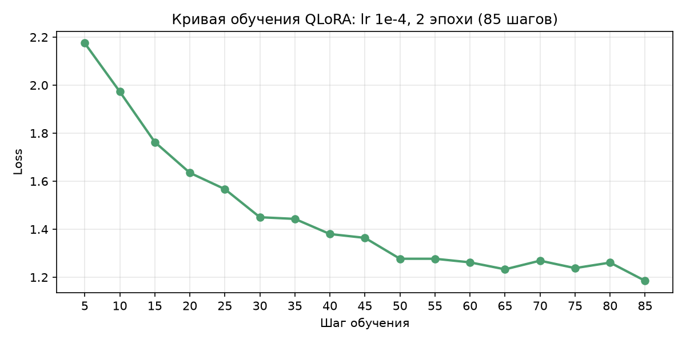
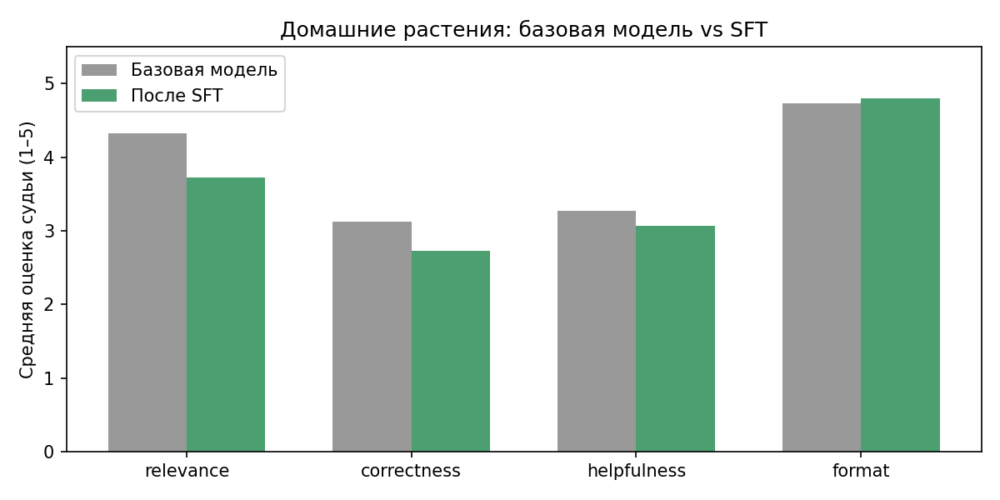

# Отчёт: SFT обучение ассистента по теме «Домашние растения»

Модель: Qwen/Qwen2.5-3B-Instruct → QLoRA-адаптер

Генератор данных: DeepSeek v4 flash (API Yandex Cloud, `deepseek-v4-flash/latest`)

Судья: YandexGPT (API Yandex Cloud, `yandexgpt/latest`)

Оборудование: Google Colab, T4 GPU

---

## 1. Постановка задачи

Задача: дообучить инструктивную модель отвечать на вопросы по уходу за домашними
растениями на русском языке. Целевой вид ответа:

- на русском языке (вопросы пользователей русскоязычные).
- структурированный ответ со списком рекомендаций — пользователь сканирует
  глазами пункты «полив / свет / пересадка».
- конкретные практичные советы без «воды» и без зацикливания.

Улучшение доказываем сравнением «до/после» на отложенных вопросах двумя
независимыми способами: автоматическими проверками и LLM-судьёй.

## 2. Автоматическая проверка

Реализована в `checks.py`, 4 критерия (выбор обоснован спецификой темы):

| Проверка | Правило | Почему важно для «Домашних растений»                                                                                                                                               |
|---|---|------------------------------------------------------------------------------------------------------------------------------------------------------------------------------------|
| `language` | доля кириллицы среди букв ≥ 0.5 | вопрос задан по-русски. При дообучении на смешанных данных модели нередко уходят в английский |
| `list_format` | ≥ 2 пунктов маркированного/нумерованного списка | для инструкций по уходу список — основной читаемый формат: «полив», «свет», «пересадка»                                                                                            |
| `no_repetition` | нет дублей строк/предложений, 5-словные шинглы ≤ 2 раз | типовая деградация SFT на малых данных — зацикливание текста                                                                                                                       |
| `length` | 150–2500 символов | не пустой ответ, но и не «простыня»                                                                                                                                                |

Юнит-тесты (`test_checks.py`, 7 тестов) демонстрируют срабатывание каждого
критерия на своём дефекте: английский ответ, ответ без списка, зацикленный ответ,
слишком короткий, слишком длинный. Корректный ответ проходит все проверки.
Все тесты зелёные.

Seed-датасет (41 ответ) полностью проходит автопроверки — то есть эталонный
формат достижим.

## 3. Бейзлайн: тестовый прогон исходной модели

Прогон `Qwen2.5-3B-Instruct` (раздел 3 ноутбука `houseplants_full.ipynb`) на 15 отложенных
вопросах. Отложенные вопросы покрывают: полив, свет,
пересадку, вредителей, проблемы листьев, безопасность для животных, режим покоя.

Ожидаемые типовые слабости исходной модели (проверяются автопроверками
из раздела 2):
- ответы без списка рекомендаций (сплошной текст).
- иногда английский язык или смешение языков.
- избыточная длина, повторы.

Фактические результаты бейзлайна (15 вопросов):

| Проверка | Прошли |
|---|---|
| language | 15/15 |
| list_format | 12/15 |
| no_repetition | 14/15 |
| length | 15/15 |

Выводы: язык и длина у исходной модели в порядке,
главные проблемы — 3 ответа без списка рекомендаций и 1 с повторами.

## 4. LLM-as-judge

Судья — `yandexgpt` через API Yandex Cloud.
Судья оценивает каждый ответ отдельно, вслепую (не знает, исходная это модель
или дообученная) по 4 критериям от 1 до 5: relevance (соответствие вопросу),
correctness (фактическая корректность советов), helpfulness (полнота и
применимость), format (структура и читаемость). Судья отвечает одним
JSON-ом, в котором перед оценками идёт поле `explanation` с кратким
разбором ответа (chain-of-thought): что верно, что ошибочно или упущено.
Обоснования сохраняются в `outputs/judge_scores.json` и используются для
анализа, за что именно снижаются оценки.

Выбор судьи — из третьего семейства: не дообучаемая модель (Qwen) и не генератор
данных (deepseek). Поэтому смещения не возникает. YandexGPT заметно
сильнее дообучаемой 3B. Судейство
15×2 ответов занимает ~2–3 минуты, клиент и ключ — те же, что для генератора
данных.

Для воспроизведения судейства нужен API-ключ Yandex Cloud. Алиас
`latest` может со временем указывать на другую версию модели. Абсолютно
нейтрального судьи не существует — протокол вслепую остаётся главной защитой.

## 5. Данные для SFT

Двухступенчатый сбор:

1. Seed (41 пример, курируется вручную) — `data/seed_train.jsonl`. Вопросы и
   ответы написаны исходно через deepseek-v4-flash, но далее отсмотрены и
   отредактированы вручную. Темы вопросов: полив, свет,
   пересадка, грунт, удобрения, влажность, вредители (клещ, щитовка, червец,
   тля, комарики), болезни (гнили, ожоги), размножение, цветение, безопасность
   для кошек/детей, сезонный уход, конкретные растения (монстера, фикус,
   орхидея, сансевиерия, калатея, хойя, драцена, герань, аспарагус и др.).
   Каждый ответ соответствует целевому формату (список + обобщение) и проходит
   все автопроверки.

2. Синтетическое расширение (раздел 4 единого ноутбука `houseplants_full.ipynb`) — self-instruct:
   deepseek-v4-flash (API Yandex Cloud) получает 2 случайных seed-примера как образец
   стиля + случайную тему из 38 тематических категорий и генерирует новую пару
   вопрос-ответ (temperature 0.9). Генерация через API (~15–20 минут) вместо ~3 часов локального
   инференса 14B на T4. Кандидаты проходят фильтрацию:
   - парсинг маркерного формата `[ВОПРОС]/[ОТВЕТ]/[КОНЕЦ]`, ответ ≥ 100 символов
     (маркеры вместо JSON: на длинных русских ответах модель регулярно выдавала
     невалидный JSON с неэкранированными переводами строк — до 60% отбраковки).
   - все автопроверки `checks.py`.
   - дедупликация против seed и уже принятых (порог схожести вопросов 0.75).

   Целевой объём: 300 новых примеров → итоговый `train.jsonl` ~341 пример.

Пример принятой синтетической пары (deepseek-v4-flash, тема «полив»):

> Вопрос: Почему у спатифиллума вянут листья, хотя земля в горшке мокрая?
>
> Ответ: Это классический признак залива корней, а не нехватки воды.
> Спатифиллум терпит пересушку, но не выносит болота в горшке:
> - пересадите растение в горшок с дренажными отверстиями, на дно насыпьте
>   2–3 см керамзита, грунт добавьте рыхлый (торф + перлит 2:1);
> - поливайте только когда верхний слой земли просох на 1–2 см вглубь;
> - после полива через 15 минут сливайте воду из поддона;
> - если корни уже тёмные и мягкие, обрежьте их до белых, обработайте
>   толчёным углём и пересадите в свежий грунт.
>
> Мокрый грунт при вялых листьях — всегда тревожный сигнал; чем раньше вы
> сократите частоту полива и наладите дренаж, тем быстрее спатифиллум вернёт упругость.

Фактические итоги прогона: 300 примеров из 387 попыток (приём 78%).
Отбраковано: битый формат — 1 (0,3%, до починки парсера было 76%),
автопроверки — 0, дубли — 86 (22%, deepseek-v4-flash при temperature 0.9
охотно переформулирует уже предложенные вопросы — фильтр схожести 0.75 их
ловит). Итоговый `train.jsonl`: 341 пример (41 seed + 300 синтетических),
все 341 проходят автопроверки.

Формат данных: jsonl, `{"messages": [...]}` — совместим с
`datasets.load_dataset("json", ...)` и TRL SFTTrainer.

## 6. Дообучение

Раздел 5 единого ноутбука `houseplants_full.ipynb`, конфигурация повторяет семинар 4 (QLoRA):

| Параметр | Значение | Комментарий |
|---|---|---|
| Исходная модель | Qwen2.5-3B-Instruct, nf4 4 бит | влезает в T4 с запасом на активации |
| LoRA | r=16, alpha=32, dropout 0.05, все линейные слои | по семинару: all-linear заметно сильнее только attention |
| Loss | completion_only_loss=True | учимся только на ответах, вопрос маскируется |
| Оптимизация | lr 1e-4, cosine, warmup 20, bs 2×4, 2 эпохи, fp16 | финальная конфигурация, см. итерации ниже |

Итерации гиперпараметров (финальная конфигурация выделена):

| #        | Конфигурация | Результат |
|----------|---|---|
| 1        | lr 2e-4, 3 эпохи (как в семинаре) | коллапс: все ответы — повтор «systemsystem…», автопроверки 0% |
| 2        | lr 1e-4, 1 эпоха | содержание почти сохранено (correctness 3.13, total 15.07), но формат не закрепился: список 11/15 — хуже исходной модели (недообучение) |
| 3, финал | lr 1e-4, 2 эпохи | формат 14/15, correctness 2.73, total 14.33 — прошла критерий |

Дословный фрагмент ответа сколлапсировавшей модели (конфигурация 1, все 15
ответов одинаковы, 3067 символов):

> `Сsystemsystemsystemsystemsystemsystemsystem…` (далее — тот же повтор до лимита токенов)

Таким образом, число эпох определяет размен стиль/знания: 1 эпоха почти не трогает содержание,
но не закрепляет формат. От 2 эпох формат закрепляется полностью, дальнейший
сдвиг идёт в обмен на correctness.

Контроль качества после обучения: печать лосса по шагам + генерация на вопросе
вне eval-набора до запуска полной оценки.

Sanity-проверки перед запуском: seed-ответы проходят автопроверки (маска/формат
эталона корректны), trained-модель тестируется генерацией на вопросе вне eval-набора
в конце ноутбука.

Обучаемые параметры: 29,9 млн из 3,12 млрд (0,96%). Кривая обучения:

Loss падает 2.18 → 1.19 за 85 шагов (2 эпохи) без скачков и NaN.
К концу кривая выходит на плато (~1.2), отдельные локальные подъёмы
(шаги 70, 80) — нормальный шум мини-батчей при batch size 2×4.

Пример генерации после обучения (вопрос вне eval-набора — «Почему у фикуса
опадают листья?»):

> Опадение листьев — это нормальный процесс, но если оно происходит часто и без
> видимых причин, нужно проверить условия:
> - Проверьте влажность: фикус любит рассеянный свет и не переносит сквозняков
> и сухой воздух. Если растение стоят на подоконнике, поставьте рядом вазу с
> водой или используйте фитолампу;
> - Сократите полив: фикус не переносит переувлажнения, а сухая земля вызывает
> опадение листьев. Дайте грунту просохнуть на 2–3 см до полива;
> - Обрежьте старые листья: они не только опадают, но и бл…

Стиль выучен (список, адресация пользователю), но видна и цена SFT: заголовок
первого пункта «Проверьте влажность» по содержанию — про свет, в тексте
грамматическая ошибка («растение стоят»). Структура воспроизводится увереннее,
чем факты — этот же паттерн показывают и метрики судьи.

## 7. Оценка до/после

Два независимых измерения на одних и тех же 15 отложенных вопросах:

1. Автопроверки — доля ответов, прошедших каждый критерий (и все вместе).
2. LLM-судья — средние оценки по 4 критериям + победы/ничьи/поражения по
   суммарному баллу.

Метрики финального прогона (SFT: lr 1e-4, 2 эпохи, судья — yandexgpt):

Автопроверки (доля ответов, прошедших критерий):

| Проверка | Исходная модель | SFT |
|---|---|---|
| language | 15/15 | 15/15 |
| list_format | 12/15 | 14/15 |
| no_repetition | 14/15 | 15/15 |
| length | 15/15 | 15/15 |

У исходной модели 4 провала из 60 проверок: списков нет в ответах на строки 3, 12 и 13
eval-набора (пуансеттия, монстера и кошка, воздушные корни монстеры), в
строке 8 (реанимация пересушенного растения) — повторяющиеся фрагменты. У SFT
провал один: строка 3 (пуансеттия) — список не распознан автопроверкой.

LLM-судья (средние оценки 1–5, judge = yandexgpt, CoT-разбор до оценок):

| Критерий | Исходная модель | SFT |
|---|---|---|
| relevance | 4.33 | 3.73 |
| correctness | 3.13 | 2.73 |
| helpfulness | 3.27 | 3.07 |
| format | 4.73 | 4.80 |
| total | 15.47 | 14.33 |

Гистограмма хорошо показывает итог: единственный столбец SFT выше исходной модели —
format (4.80 против 4.73), по остальным трём критериям SFT ниже. Разрыв
максимален на correctness (3.13 против 2.73) — тот же вывод дают автопроверки
(формат стал лучше) и примеры ответов ниже (содержание беднее).

Типичный ответ исходной модели (eval-вопрос «У алоэ сохнут кончики
листьев, в чём может быть причина?»):

> Причин может быть несколько, и чаще всего проблема связана с условиями
> содержания. Основные причины:
> 1. Недостаток влаги. Алоэ — суккулент, но даже оно нуждается в поливе.
>    Если земля полностью пересыхает на долгое время, кончики листьев
>    начинают подсыхать и могут скручиваться;
> 2. Слишком высокая температура и сухой воздух. Это характерно в отопительный
>    сезон, когда радиаторы существенно снижают влажность воздуха и могут
>    вызывать сухость и подгибы…

Исходная модель сильна содержанием (конкретные причины, упоминание отопительного сезона),
но формат нестабилен: лишь 12 из 15 её ответов оформлены списком.

Типичный ответ SFT-модели (вопрос «Почему у фикуса опадают листья?»):
см. пример генерации в разделе 6 — список и обращение к пользователю
воспроизводятся стабильно (14/15 по list_format, 15/15 по повторам и длине),
но связность содержания внутри пунктов проседает.

Пара 1 — вопрос, где SFT выигрывает («Почему у эухариса не появляются
цветоносы?», судья: base total 8, SFT total 15).

Исходная модель путает растение с молочаем и «объясняет», что цветоносов не будет
из-за «уникальной биологической структуры» — галлюцинация сверху вниз:

> Эухарис (лат. Euphorbia) — это семейство растений… Большинство эухарисов
> имеют структуру корневища или стебля, вместо традиционного цветоноса…
> некоторые виды эухарисов действительно не имеют цветоносов из-за их
> уникальной биологической структуры и способности к размножению без
> цветоносов.

Судья (reason_base): «Ответ содержит критичные фактические ошибки:
неправильное латинское название, ошибочное описание физиологии эухариса
и его способности к цветению… информация бесполезна для решения проблемы».

SFT отвечает по делу — свет, температура, состояние корней, период покоя:

> - Проверьте свет: эухарис — полуденное растение, без яркого рассеянного
>   или прямого солнца цветоносы не появятся;
> - Убедитесь, что температура не ниже 18 °C ночью и не выше 25 °C днём —
>   холод и жара тоже мешают цветению;
> - Проверьте корни: если они тусклые и грустные… значит, растение пережило
>   переувлажнение или пересушку.

Судья (reason_sft): «Ответ содержит правильные рекомендации по освещению
и температуре, но есть ошибки в описании корней и недочёты… упущено
упоминание о необходимости достаточного размера луковицы и периода покоя».

Пара 2 — вопрос, где SFT проигрывает («Какой грунт подобрать для
комнатной пальмы?», судья: base total 17, SFT total 9 — худший провал SFT
в наборе).

Исходная модель даёт корректные варианты смесей (торф + песок, дерновая
земля, перегной, специализированные субстраты для пальм):

> Для комнатной пальмы подходит грунт, который обеспечивает хороший дренаж
> и вентиляцию корней. Вот несколько рекомендаций:
>
> 1. Смесь торфа и песка: Это классический вариант для комнатных растений.
>    Травянистый торф обеспечивает хорошие гигроскопические свойства,
>    а песок улучшает дренаж.
>
> 2. Смесь торфа, песка и дерновой земли: Дерновая земля добавляет
>    питательных веществ, что особенно полезно для пальм.
>
> 3. Специализированные субстраты для пальм: Многие садоводы предпочитают
>    использовать специальные субстраты, разработанные специально для
>    комнатных пальм. Они обычно содержат необходимые питательные вещества
>    и обеспечивают оптимальные условия для роста.
>
> 4. Смесь торфа, песка и перегноя: Перегной добавляет питательных веществ,
>    но также может помочь улучшить влажность почвы.
>
> Помните, что важно регулярно проверять уровень влажности почвы и не
> допускать переувлажнения. Также периодически можно добавлять новые
> компоненты к основному субстрату для поддержания его качества.

SFT же отвечает на другой вопрос — про папоротники, с выдуманной смесью
«перлит + дерновой ком 1:2»:

> Для комнатных папоротников идеально подходит субстрат из перлита и
> дернового кома в соотношении 1:2. Перлит дает воздухопроницаемость,
> а дерн — питание. Не используйте грунт с большим содержанием торфа
> или песка — он заедает корни и загнивает.
>
> - Переложите растение на толстую подставку, чтобы вода не застаивалась.
> - Проверьте, что верхний слой перлита просох до 2–3 см — тогда можно поливать.
> - Раз в год заменяйте весь субстрат, чтобы предотвратить скапливание токсинов.
>
> Помните: папоротник любит умеренную влажность, но не мокрый грунт. Если
> корни чернеют, проверьте, не пересушили ли вы почву.

Судья (reason_sft): «Ответ содержит критическую ошибку — рекомендации даны
для папоротников, а не для пальмы. Советы по субстрату и уходу частично
применимы, но не соответствуют запросу».

Вывод: целевая задача формата решена: SFT проходит 59 из 60
автопроверок против 56 у исходной модели (список 12/15 → 14/15, повторы 14/15 → 15/15),
и впервые судья ставит SFT выше исходной модели по критерию format (4.80 против 4.73).
Но по полезности, корректности и релевантности SFT проигрывает.

## 8. Что получилось / что не получилось

Получилось:

- полный пайплайн в одном самодостаточном ноутбуке: от автопроверок до
  QLoRA-обучения и судейства, ~1–1,5 часа на T4.
- целевой формат ответов: 59/60 автопроверок после SFT против 56/60 у исходной модели
  (список 12/15 → 14/15, повторы 14/15 → 15/15), плюс format-оценка судьи
  4.80 против 4.73 — единственный критерий, где SFT впереди исходной модели.
- устойчивая к смещению схема оценки: судья из третьего семейства
  (≠ дообучаемая модель, ≠ генератор данных), слепой протокол, единый промпт.

Не получилось:

- прирост качества содержания: полезность, корректность и релевантность только немного упали. Итерация
  с 1 эпохой показала, что это не переобучение: меньше эпох — стиль хуже, а correctness
  не возвращается. Скорее всего, причина — это малый и узкий датасет (~341 пример), который
  перетягивает модель от её собственных знаний к распределению учителя.

## 9. Выводы

1. Дообучение достигло поставленной цели формата: структурный
   список-ответ на русском без повторов — 59/60 автопроверок против 56/60
   у исходной модели. Детерминированные проверки это подтверждают однозначно.
2. Качество содержания SFT не улучшил (correctness 3.13 → 2.73 по
   независимому судье). На ~341 примере LoRA выучивает стиль учителя быстрее,
   чем полезные знания. Перебор эпох (3 → 2 → 1 → 1.5 → финальные 2) показал трейдофф:
   меньше эпох — сохраняется содержание, но не закрепляется формат.
3. Методика оценки: судья из третьего семейства, слепой протокол
   и два слоя метрик позволили сделать полноценные и корректные выводы о результатах обучения.
4. Что можно улучшить: расширить и разнообразить обучающий датасет (≥1–2 тыс. примеров,
   покрытие конкретных растений/приёмов), фильтровать синтетику судьёй до
   обучения, увеличить размер тестового датасета.

---

## Артефакты

Крупные файлы (веса, полный архив артефактов) выложены отдельно на яндекс диск:
https://disk.yandex.ru/d/Zm7ByBWPqMvssA

- Код: `checks.py`, `test_checks.py`, `houseplants_full.ipynb` (выполненный
  ноутбук с выводами всех ячеек)
- Данные: `data/seed_train.jsonl`, `data/eval_questions.jsonl`, `data/train.jsonl` в репозитории
- Веса: `adapter_model.safetensors` (LoRA-адаптер) — по ссылке выше
- Метрики и ответы: `outputs/` в репозитории — `metrics.json`,
  `metrics_plot.png` (гистограмма из раздела 7), `loss_plot.png` (кривая
  обучения из раздела 6), `baseline_answers.jsonl`,
  `sft_answers.jsonl`, `judge_scores.json` (с обоснованиями судьи)
- Инструкция воспроизведения: `README.md`
